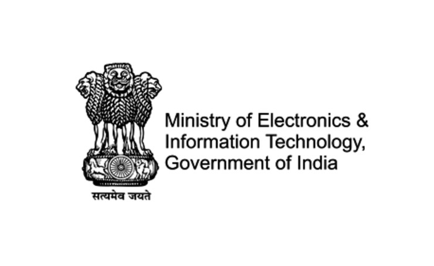
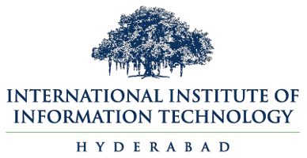

# UASAT

<!-- 

 -->

<!--  -->

  

   <!-- Styling done in css/main.scss (Observation: Styles work well when placed in main.scss when compared to inline style) -->
  <!-- 
Your text goes here.
 -->

The project **SwaYaan-Capacity Building Human Resource Development(UASAT)**, MeitY in Unmanned Aircraft System 'Drone and related Technology’ for 5 Year duration from 2022-2027. The project aims at creating a full-fledged National ecosystem in UAS and Drone related technologies with the following objectives:
				
- To enhance capacity & capabilities of selective institutions in identified WTs (Work Themes) on Unmanned Aircraft Systems.
- To institutionalize a collaborative ecosystem through identified Resource Centres (RCs) and Participating Institutions (PIs) for synergy of capabilities & expertise.
- To foster development of competent human resources at various levels including Post Graduate & Graduate programs, PG Diploma/Certificate programs, Faculty Development and Master Trainers in niche areas of UAS.
- To promote entrepreneurial mindset and nurture technical talent among the student community through innovative interventions such as Bootcamps and Proof-of Concepts.
- To nurture technical talent and ideation among the student community through IPR generation, Competitions, Workshops / Conferences, etc.

In this regard, five Work-Themes are identified to create a full-fledged ecosystem in UAS/Drone and related technologies. The Work Theme (WT) includes: 
- Drone Electronics (involving Sensors, Onboard Computers, Communication Technology etc.)
- GNC Algorithms & Simulation 
- Aeromechanics 
- Drone Applications (including domain-specific applications & security) 
- Allied UAS Technologies (Data Analysis, AI/ML, loT, Cloud Computing etc.)

### Project UASAT aims to achieve the following deliverables and targets: 

It aims to meet various deliverables and targets through implementation of various components under three major Activity Verticals including:
- Capacity and Capability building,
- Ideation and Innovation
- Human Resource Development with an aim to create around 40,000 + Professionals trained in Drones and related areas through 1500+ activities over the period of 5 Years.

To accomplish the objectives under the defined work-themes, a National Ecosystem is being created by 30 Institutions distributed across various states of India in a hub and spoke model with five IISc/IITs/IIITs as Resource Centres (RC), fifteen IITs, NITs and IIITDMs as Participating Institutes (PI-Academic) and ten C-DAC/NIELIT Centres as Participating Institutes (PI-C-DAC/ NIELIT Centres) to conduct various activities under different verticals with IIITDM, Kurnool and C-DAC, Hyderabad as a part of Project Management Unit (PMU)

### NPTEL Course

**Principles of Perception and Planning for Aerial Vehicles**

The NPTEL course covers the principles of perception and motion planning for aerial vehicles, including UAV modelling, camera-based perception, SLAM, and motion planning.

[View NPTEL Course Videos](https://robotics.iiit.ac.in/nptel/)

### WTEG Collaborators

<!-- 
 <!-- Set your desired fixed height -->

<!-- 







  











 -->































### Events organised by RRC so far as part of UASAT Project

### Master Trainer Programs (MTPs)

**Seventh Master Trainer Program – 26th – 30th October 2026.**

IIIT Hyderabad, through the Robotics Research Center (RRC), organized the seventh Master Trainer Program (MTP) for the Technology Specific Work Theme "Allied UAS Technologies", with a focus on Vision-based Navigation for UAS, from 26th to 30th October 2026 at IIITH Campus. The five-day program covered Foundations of Computer Vision, Motion Planning and Physical AI, Topographic Mapping and Path Planning, Vision-Action Policies for Navigation, Interpretable Robot Learning for Navigation, Integration of Classical Robotics with Modern AI, Applications of Vision-Language Models (VLMs), and Implementation of Autonomous Navigation for UAS. Around 23 participants attended the program.

**Sixth Master Trainer Program – 24th – 28th February 2026.**

The sixth Master Trainer Program (MTP) was conducted under the Technology Specific Work Theme "Allied UAS Technologies", with a focus on Computer Vision and Foundational Models for UAVs, from 24th February 2026 to 28th February 2026. A total of 22 participants attended the program.

**Fifth Master Trainer Program – 27th – 31st October 2025.**

IIIT Hyderabad organized the fifth Master Trainer Program (MTP) for the Technology Specific Work Theme "Allied UAS Technologies", with a focus on Computer Vision and Motion Planning for UAVs, from 27th October 2025 to 31st October 2025 at Saranga Hall, 119, Nilgiri Building, IIITH Campus. The five-day program included theory and practical sessions on Computer Vision, Sensor-based UAV Navigation, Motion Planning and Control. Practical sessions were conducted using cameras, LiDAR, IMU and other sensors used in UAVs. A total of 20 participants attended the program.

**Fourth Master Trainer Program – 3rd – 7th March 2025.**

The Fourth Master Trainer Program (MTP) for the Technology Specific Work Theme "Allied UAS Technologies", with a focus on Learning, Vision and Motion Planning, was conducted from 3rd to 7th March 2025 at Saranga Hall 119, Nilgiri Building, IIIT Hyderabad Campus. The five-day program covered foundations of computer vision, scientific machine learning, statistical issues in AI/ML, reinforcement learning, motion planning and applications to UAS. Tutorial sessions covered the implementation aspects of the different methods. The topics covered included Robot Motion Planning, Image Processing and Computer Vision, basic and advanced topics in Reinforcement Learning, Scientific Machine Learning, Non-parametric Statistics for AI/ML, Adaptive Control for Robots and Drones, MAVLink – Drone Communication Protocol, and tutorial sessions focusing on implementation and applications.A total of 22 participants attended the program.

**Third Master Trainer Program – 11th – 15th March 2024.**

IIIT Hyderabad was identified as one of the Resource Centers (RC) for the MeitY-approved project entitled "Capacity Building for Human Resource Development in Unmanned Aircraft System (Drone and Related Technology)". As a part of this project, IIIT Hyderabad organized the third Master Trainer Program (MTP) for the Technology Specific Work Theme "Allied UAS Technologies" for five days from 11/03/2024 to 15/03/2024.

**Second Master Trainer Program – 17th – 22nd July 2023.**

The second Master Trainer Program (MTP) was conducted from 17 July 2023 to 22 July 2023. The topics covered were Ardupilot, PyMAVLINK, ROS, Gazebo, OpenCV, and PyBullet. The theory part covered basic NCC (Navigation Guidance and Control) for UAV, image processing and security. There were nearly 25 participants for the MTP – Batch 2.

**First Master Trainer Program – 30th January – 3rd February 2023.**

The first Master Trainer Program (MTP) was conducted from 30 January 2023 to 3 February 2023. The topics covered were Introduction to UAV, Kinematics and Dynamics, Cyber Security for Internet of Drones, IoT, RTOS for drones, Control System, Image Processing, Arducopter, ROS, AIRSIM, OpenCV, and DGCA regulations for drones. The program concluded with a flight demonstration from Arka Aerospace. There were nearly 30 participants for the MTP – Batch 1.

### Workshops on Systems and Intelligence for UAV

**Third Workshop on Systems and Intelligence for UAV – 25th – 26th March 2026.**

The third workshop on Systems and Intelligence for UAV was organized by the Robotics Research Center (RRC), IIIT Hyderabad, with a focus on "Planning and Control of UAV Systems (Classical and Learning-Based Approaches)" on 25th and 26th March 2026. The workshop was conducted in hybrid mode at KRB Auditorium, IIIT Hyderabad Campus.

The workshop covered the following topics:
- Geofencing control of multi-agent systems in safety-critical missions
- AI-based perception and planning
- Discrete and sampling-based motion planning
- Adaptive control in aerial manipulation
- Visual Topological Navigation
- Reinforcement Learning-based planning

The speakers included Dr. Anoop Jain (IIT Jodhpur), Prof. K. Madhava Krishna, Dr. Spandan Roy, Dr. Sourav Garg, Dr. Harikumar Kandath and Dr. Antony Thomas (IIIT Hyderabad).

**Second Workshop on Systems and Intelligence for UAV – 18th – 19th December 2024.**

The second workshop on Systems and Intelligence for UAV was conducted on 18th and 19th December 2024 at IIIT Hyderabad, with a focus on Computer Vision and Artificial Intelligence. The workshop explored the integration of computer vision and artificial intelligence in UAV systems and brought together experts and participants from robotics, vision and AI for discussions and hands-on sessions.

The speakers included Dr. Makarand Tapaswi (IIIT Hyderabad), Dr. Ravi Kiran S (IIIT Hyderabad), Prof. K. Madhava Krishna (IIIT Hyderabad), Dr. Nagamanikandan G (IIIT Hyderabad), and Dr. Arun Kumar Singh (University of Tartu).

The key topics covered included:
- Focused sessions on AI and vision algorithms for UAV applications.
- Topics ranging from neural networks to geometry-based vision and SLAM.
- Sessions led by researchers from academia and industry.

**First Workshop on Systems and Intelligence for UAV – 3rd – 4th November 2023.**

The first workshop on Systems and Intelligence for UAV was conducted on 3rd and 4th November 2023 at IIIT Hyderabad.

The speakers included Prof. Venkatesham (IIT Hyderabad), Dr. Ashok Kumar Das (IIIT Hyderabad), Dr. Anjaly P (Microsoft Research), Swati Dantu (Czech Technical University), Dr. Shuvrangshu Jana (National University of Singapore), Dr. Arun Kumar Singh (University of Tartu), and Dr. Jinraj V Pushpangathan (Tata Elxsi).

The topics covered included:
- System design of passenger drone
- Arka Aerospace, Research to Product
- A brief summary of recent works on quadrotor(s) motion planning at University of Tartu
- Autonomous multi-agent systems for collaborative interception
- IoT-Enabled Internet of Drones (IoD), its Security Issues and Application using Blockchain Technology
- Coupling Effects on the Dynamics of a Fixed-Wing Nano Aerial Vehicle
- Intelligent Anti-Swing Controller for Safe Human Interaction in Quadrotors with Cable Suspended Payload

 

